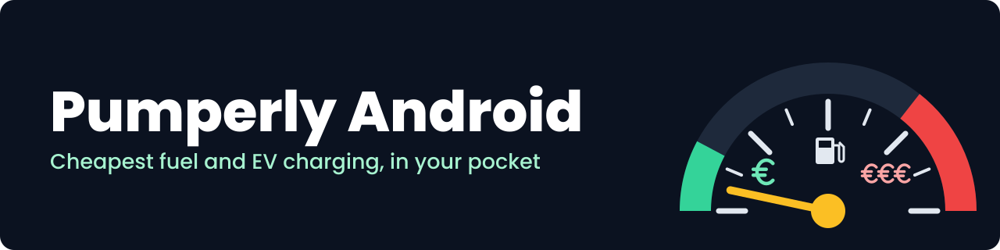
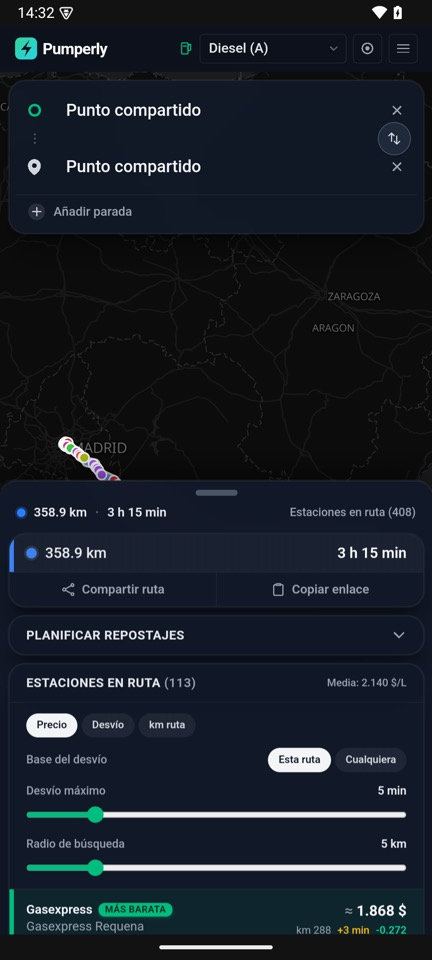
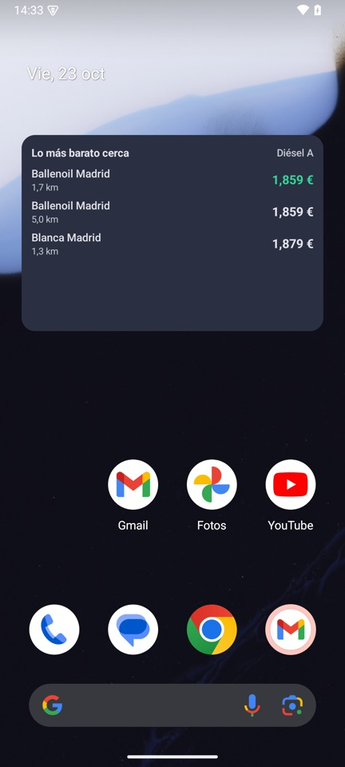
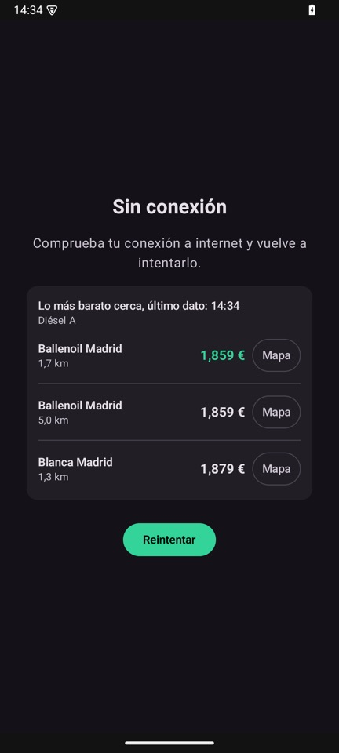
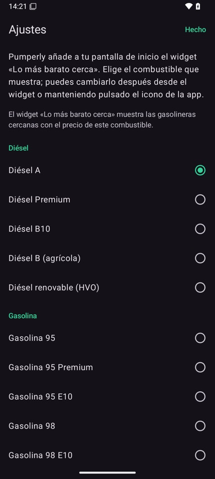
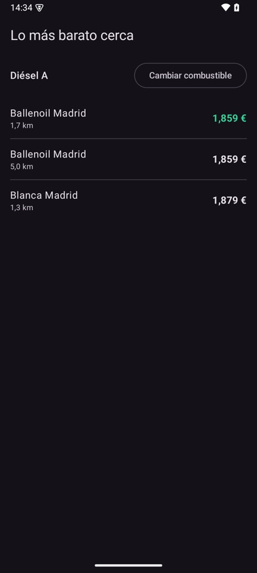

  

<h1 align="center">Pumperly for Android</h1>

  
  

The Android app for [Pumperly](https://github.com/GeiserX/Pumperly), the open-source fuel and EV route planner. It shows [pumperly.com](https://pumperly.com) in a WebView and adds native parts that work without the site: a home-screen widget with the cheapest stations nearby, a "Cheapest nearby" screen, the last known prices when you are offline, and a fuel setting.

  
  
  
  
  

## Features

- **Full Pumperly site**: route planning, real-time fuel prices, EV charging, stations along the route
- **Home-screen widget**: the cheapest stations near you for your fuel, 2x2 (one station) or 4x2 (three). It refreshes hourly and when you open the app, and never asks for background location: it uses the position the app saved the last time it was open
- **Cheapest nearby**: touch and hold the app icon for a screen with the same three stations
- **Offline**: with no connection the app shows up to three stations from the last lookup, with a button to open each in your map app
- **Widget fuel**: picked on first launch, changed from the widget header or the app icon shortcut
- **Spanish and English**, following the system or the per-app language setting
- **Deep links**: `pumperly.com` links open in the app
- **Dark mode** and pull to refresh
- **Small**: the release APK is about 2 MB, with no Google Play services and no tracking

## Quick start

Download `app-release.apk` from the [latest release](https://github.com/GeiserX/Pumperly-android/releases/latest), open it on the phone and allow installs from that source. Needs Android 8.0 (API 26) or later.

The app is not on Google Play yet. To build it yourself, see [Development](docs/development.md).

## Documentation

- [How it works](docs/how-it-works.md): the WebView shell and what stays native
- [Development](docs/development.md): debug build, signed release build, version properties

## Related projects

| Project | Description |
|---------|-------------|
| [Pumperly](https://github.com/GeiserX/Pumperly) | Main web app — fuel & EV route planner |
| [pumperly-mcp](https://github.com/GeiserX/pumperly-mcp) | MCP Server for AI assistants |
| [pumperly-ha](https://github.com/GeiserX/pumperly-ha) | Home Assistant integration |
| [n8n-nodes-pumperly](https://github.com/GeiserX/n8n-nodes-pumperly) (archived) | n8n community node |

## License

[GPL-3.0-or-later](LICENSE). Made by [Sergio Fernandez](https://github.com/GeiserX).
